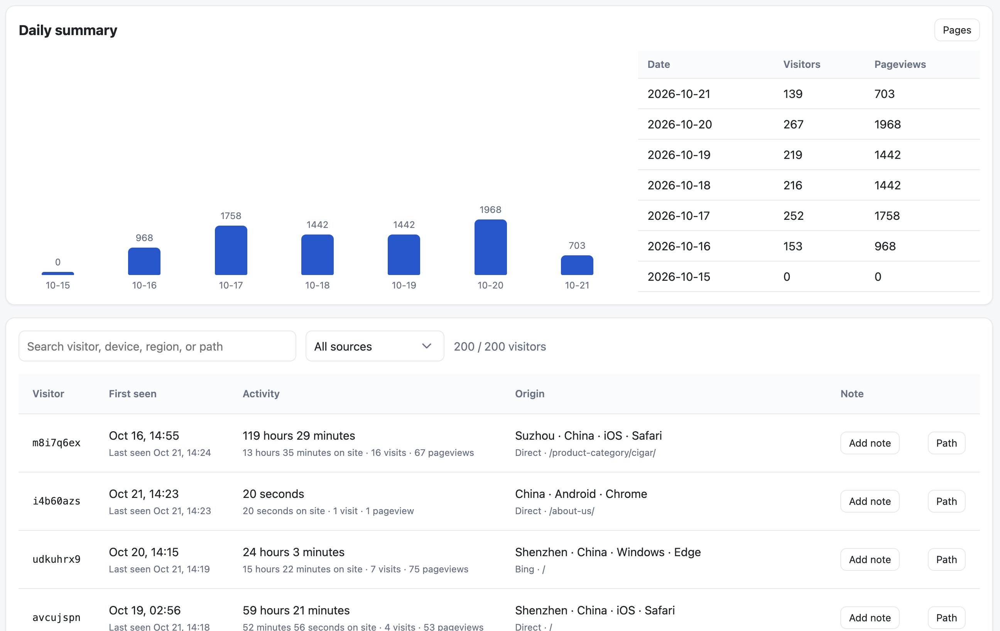
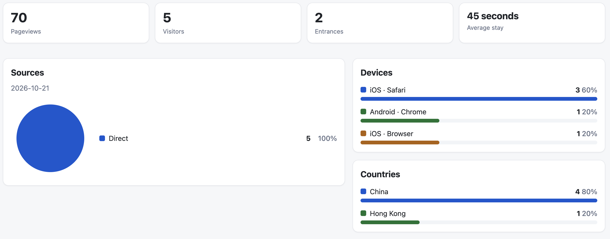
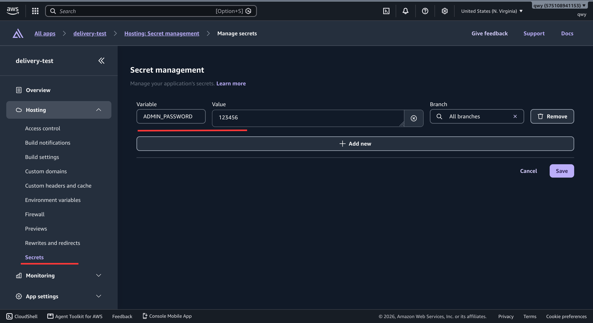

# Site metrics by AWS Amplify

Site metrics is the web analytics app for Fatleon. It is deployed on AWS Amplify Hosting. Connect this Git repository in the Amplify console and Amplify builds it on every push. You do not need your own domain. The default `amplifyapp.com` URL is enough for the admin and for the tracking script.

It records pageviews, visitors, referrers, devices, and time on page. The tracker and the data stay on that Amplify app.

## Features





- One script tag records pageviews and follows client-side navigation
- The admin shows daily visitors, the last 7 days, and a per-page source pie chart with device, country, entrances, and average stay
- Each visitor has a landing page, path, region, language, UTM tags, and a private note
- An optional feedback box stays off until you turn it on for that site
- One admin user, and as many sites as you want

The script keeps a visitor id in `localStorage` rather than a tracking cookie, and it ignores common bots. A visit that starts again after 30 minutes counts as a new visit. Raw visits are kept for 90 days. Daily totals and per-page breakdowns are kept for 400 days. Query strings are not separate pages. Source is the first external site a person came from. Country and city come from CloudFront viewer headers.

## Cost

You do not rent an EC2 server. Amplify Hosting runs this Next.js app and charges only for what it uses. A quiet deployment usually stays under $1 a month.

[AWS Amplify pricing](https://aws.amazon.com/amplify/pricing/) bills a standard build at $0.01 per minute, stored data at $0.023 per GB-month, data transfer out at $0.15 per GB, and server-side rendering at $0.30 per million requests plus $0.20 per GB-hour. For 12 months, a new AWS account includes 1,000 build minutes, 5 GB stored, 15 GB served, 500,000 SSR requests, and 100 GB-hours each month. DynamoDB and Lambda, which this app also uses, are billed separately. Check the pricing page for the current rates.

## Deploy from GitHub

Amazon Web Services walks through the same console flow: choose GitHub, pick the repository and branch, let Amplify detect Next.js, create a service role, then save and deploy.

<p align="center">
  <a href="https://www.youtube.com/watch?v=s7rh9ci3hgw">
    
  </a>
</p>

<p align="center">
  <a href="https://www.youtube.com/watch?v=s7rh9ci3hgw">Zero-config deploy of a Next.js SSR app with AWS Amplify Hosting</a> (Amazon Web Services)
</p>

In the Amplify console, create a new app, choose GitHub, and connect this repository. Use the Web Compute (SSR) platform. Do not set `STORE=file`.

After the app exists, open Hosting, then Secrets. Add a secret named `ADMIN_PASSWORD`. That value is the admin sign-in password.



The password in the screenshot is only an example. Set a strong password.

After the first deploy, open:

- Admin: `https://main.<app-id>.amplifyapp.com/admin`
- Script: `https://main.<app-id>.amplifyapp.com/<siteKey>.js`

Leave the app on that hostname. A custom domain is optional and not required.

## Add it to a site

Create a site in the admin, then paste the script before `</body>`:

```html
<script defer src="https://main.<app-id>.amplifyapp.com/abcd1234.js"></script>
```

`abcd1234` is that site’s key. Use “Open test page” in the admin to try it.

## Run locally

```bash
npm install
cp .env.example .env.local
npm run dev
```

Open `/admin`. The password is `ADMIN_PASSWORD` in `.env.local`. Local data is stored in `.data/metrics.json`.

Run `npm run check` before committing. It typechecks the Next.js app and the Amplify function, then runs the unit tests.

To point local development at the Amplify backend instead of the file store, set the admin password and start a sandbox, then remove `STORE=file` from `.env.local`:

```bash
npm run sandbox:secret
npm run sandbox
```

The sandbox identifier is `site-metrics`. `npm run sandbox:secret` prompts for `ADMIN_PASSWORD`. Set that same secret on the Amplify app before the first deploy.

If you are looking for an Amplify commerce project, see [Fatleon-Amplify-Commerce](https://github.com/Fatleon-Commerce/Fatleon-Amplify-Commerce).
